  

<h1 align="center">I'm S.M. Mehedy Kawser 👋</h1>

<h3 align="center">A Full-stack Developer from 🇧🇩 · building web apps, learning security</h3>

  
  
  
  

  
  

  <picture>
    <source media="(prefers-color-scheme: dark)" srcset="https://raw.githubusercontent.com/mehedyk/mehedyk/output/github-contribution-grid-snake-dark.svg">
    <source media="(prefers-color-scheme: light)" srcset="https://raw.githubusercontent.com/mehedyk/mehedyk/output/github-contribution-grid-snake.svg">
    
  </picture>

<b>LANGUAGES</b> 

<b>FRONTEND & APPS</b> 

<b>BACKEND & APIS</b> 

<b>DATA & AI</b> 

<b>DATABASES</b> 

<b>CLOUD & DEVOPS</b> 

<b>Security & Linux &nbsp;(actively learning)</b> 

<table align="center">
<tr><th align="left">Project</th><th align="left">What it is</th><th align="left">Stack</th></tr>
<tr><td><b><a href="https://github.com/mehedyk/Salami-SAAS">Salami SaaS</a></b></td><td>Eid gift / salami collection platform with subscription tiers paid via bKash, Nagad and Rocket.</td><td>React · TS · Flask · MongoDB · Clerk</td></tr>
<tr><td><b><a href="https://sirr-connect.vercel.app">Sirr</a></b> live demo</td><td>End-to-end encrypted chat: TweetNaCl encryption, HMAC sender auth, WebRTC calls, read receipts.</td><td>React · TS · Supabase · WebRTC</td></tr>
<tr><td><b>Portfolio Maker</b> private · capstone</td><td>Build and publish a portfolio from profession-specific themes, with a credit system and RLS-hardened security. Built with Team Galacticos.</td><td>React · Vite · TS · Tailwind · Supabase</td></tr>
<tr><td><b><a href="https://github.com/mehedyk/Numerical-Analysis">Numerical Analysis</a></b> ⭐</td><td>Root-finding workbench: bisection and false position, step-by-step animation, PDF/PNG export. Zero build step.</td><td>JS · HTML5</td></tr>
<tr><td><b><a href="https://github.com/mehedyk/QiyamBreak">QiyamBreak</a></b></td><td>Ergonomic break-reminder desktop app with themes and mini-games.</td><td>Python · PyQt6</td></tr>
<tr><td><b><a href="https://github.com/mehedyk/Git-Visualizer">Git Visualizer</a></b></td><td>Animated, mobile-first walkthrough of git commands.</td><td>HTML · CSS · JS</td></tr>
<tr><td><b><a href="https://github.com/mehedyk/Algorithm-Visualizer">Algorithm Visualizer</a></b></td><td>Watch classic algorithms run, step by step.</td><td>TypeScript</td></tr>
<tr><td><b><a href="https://github.com/mehedyk/Singulate">Singulate</a></b></td><td>Git tool for committing automatically.</td><td>Python</td></tr>
<tr><td><b><a href="https://github.com/mehedyk/Ghayb">Ghayb</a></b> early stage</td><td>A browser I'm exploring for better personal online security.</td><td>Security · Web</td></tr>
<tr><td><b><a href="https://github.com/mehedyk/LandTech-Innovation-Hackathon-2026">LandTech Hackathon 2026</a></b></td><td>Team Ardh entry for the DIU LandTech Innovation Hackathon.</td><td>TypeScript</td></tr>
<tr><td><b><a href="https://github.com/mehedyk/supershop-c-cli">supershop-c-cli</a></b> ⭐</td><td>CLI-based Super Shop management system.</td><td>C</td></tr>
<tr><td><b><a href="https://github.com/mehedyk/library-management-system-java-gui">Library Management System</a></b> ⭐</td><td>Swing GUI with admin and member logins, book management and borrow/return flow.</td><td>Java · Swing</td></tr>
</table>

Also: <a href="https://github.com/mehedyk/Dristy-Institute">Dristy Institute</a> · <a href="https://github.com/mehedyk/Fard-Vault">Fard Vault</a> · <a href="https://github.com/mehedyk/Quran-Assistant">Quran Assistant</a> · <a href="https://mehedy.netlify.app">my portfolio</a> 
Problem solving in C++: <a href="https://github.com/mehedyk/100-CodeForces-Problems">Codeforces</a> · <a href="https://github.com/mehedyk/100-HackerRank-Problems">HackerRank</a> · <a href="https://github.com/mehedyk/100-BeeCrowd-Problems">BeeCrowd</a> · <a href="https://github.com/mehedyk/LeetCode-75-Blind-75">LeetCode 75</a>

  
  

  

  

  

  

  
  
  

  <b>Open for collaborations, freelance projects, or just a tech chat.</b> 
  open source · freelance · tech, tools &amp; philosophy · a virtual coffee

"Code is poetry written in logic" · from <a href="https://github.com/mehedyk">mehedyk</a>

